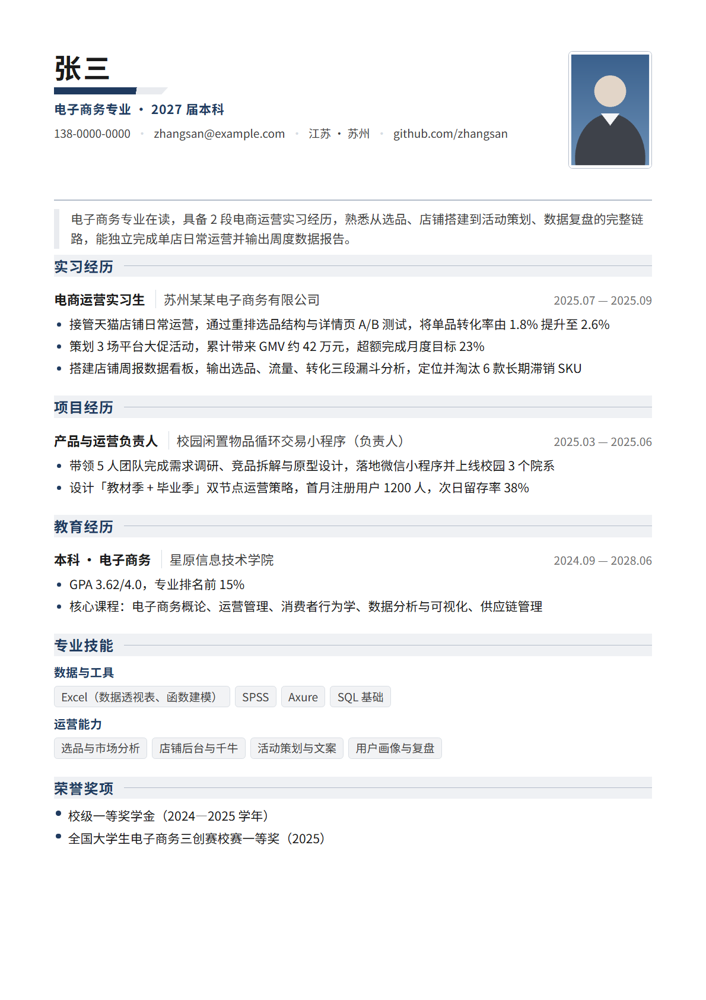
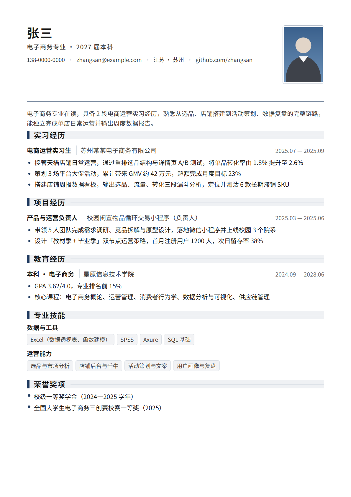
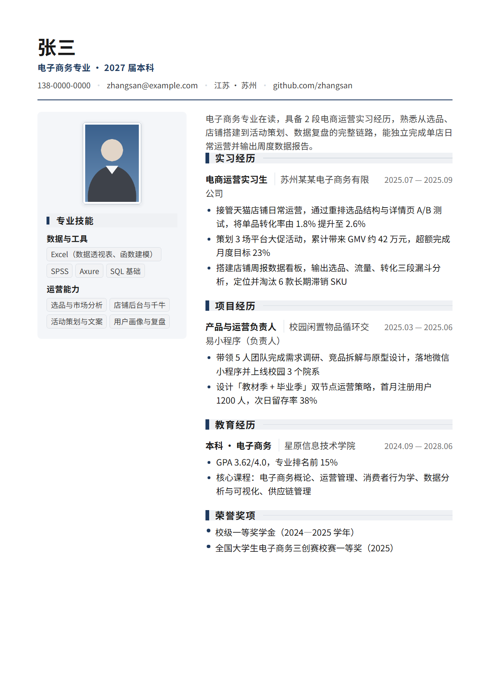

# resume-crafter · 简历工坊

> 从口述经历到可投递简历，一句话生成 · 面向应届毕业生与职场人

[](https://www.python.org/)
[](LICENSE)
[]()
[](https://www.workbuddy.cn)

一个开源的 **AI 简历生成 Skill**：你只需用大白话讲清楚自己做过什么，它就能产出排版精美、能过 ATS 机筛的简历，还能按目标岗位 JD 定制、批量出多版本，并附上求职信与面试准备清单。

<p align="center">
  
  
  
</p>

---

## 核心能力

| 能力 | 说明 |
|---|---|
| 🗣️ **口述成稿** | 大白话描述经历，自动结构化为标准简历 JSON |
| 🎨 **9 套排版版式** | 经典单栏 / 现代单栏 / 精英几何 / 霓虹渐变 / 几何卡片 / 学术严谨 / 双栏侧边栏 / 柔光双栏 / 创意顶栏 |
| 📷 **一寸照片位** | 内嵌 base64，PDF 与 Word 三端一致；无照片时输出标准尺寸占位框 |
| 🎯 **JD 定制** | 解析岗位职责/任职要求/加分项，按优先级给出改写建议 |
| 📦 **批量出简历** | 一份底稿 → 投 N 家公司自动生成 N 版，每份带独立匹配报告 |
| 🔍 **ATS 体检** | 检测 PDF 文本层是否可解析、是否跨栏错序、页数是否失控 |
| ✉️ **求职信 + 面试清单** | 定制求职信、JD 相关面试题、回答框架、投递前自查表 |

## 设计理念

- **绝不编造经历。** JD 要求但你不具备的技能，工具只报告、不代填，投不投递由你决定。
- **文字是资产。** 全部内容是真实可选中的文本，不做图片化文字、不用图标字体，保证 ATS 可解析。
- **单一主色 + 黑灰。** 参考 Canva、五百丁、乔布、Boss 直聘付费模板的视觉手法，但按 HR 阅读习惯做了克制度过滤。
- **改写留痕。** 文案润色会明确告知改了什么、为什么改，你可以否决。

---

## 快速开始

### 方式一：作为 WorkBuddy Skill 使用（推荐）

克隆到 WorkBuddy 的技能目录：

```bash
git clone https://github.com/<your-name>/resume-crafter.git \
  ~/.workbuddy/skills/resume-crafter
# Windows: %USERPROFILE%\.workbuddy\skills\resume-crafter
```

重启 WorkBuddy 后即可使用。对话中说「帮我做一份简历」或「按这个 JD 改我的简历」即可触发。

### 方式二：作为独立命令行工具使用

```bash
git clone https://github.com/<your-name>/resume-crafter.git
cd resume-crafter

# 建议使用虚拟环境
python -m venv .venv && source .venv/bin/activate   # Windows: .venv\Scripts\activate
pip install -r requirements.txt

# 一键构建：质检 → HTML → PDF → DOCX → ATS 体检
python scripts/build_all.py my-resume.json --out ./out --style classic --name "张三-电商运营实习生"
```

输出文件：

```
out/
├── 张三-电商运营实习生.html   # 用于预览和改版
├── 张三-电商运营实习生.pdf    # 用于投递（文本型，ATS 可解析）
├── 张三-电商运营实习生.docx   # 用于后续修改
```

---

## 简历数据格式

简历 JSON 是唯一事实来源。最小示例：

```json
{
  "meta": { "style": "classic", "surface": "white", "palette": "indigo" },
  "basic": {
    "name": "张三",
    "title": "电子商务专业 · 2027 届本科",
    "photo": "my-photo.jpg",
    "photo_size": "1in",
    "photo_shape": "rect",
    "contact": [{ "type": "phone", "text": "138-0000-0000" }]
  },
  "summary": "一段 60—120 字的定位概述",
  "sections": [
    {
      "id": "experience", "title": "实习经历", "type": "experience",
      "items": [{
        "org": "某公司", "role": "电商运营实习生",
        "start": "2025.07", "end": "2025.09",
        "bullets": ["动词 + 做法 + 量化结果"]
      }]
    },
    { "id": "skills", "title": "专业技能", "type": "skills",
      "groups": [{ "label": "数据与工具", "items": ["Excel", "SQL"] }] }
  ]
}
```

### 照片字段

| 字段 | 取值 | 说明 |
|---|---|---|
| `photo` | 本地路径 / URL / base64 | 相对路径以 **简历 JSON 所在目录** 为基准 |
| `photo_size` | `1in`(25×35mm) / `small1in` / `2in` / `square` / `boss`(200×250px) | 标准证件照规格 |
| `photo_shape` | `rect`(默认) / `rounded` / `circle` | 矩形最通用，圆形成像片在部分体制内不被接受 |

未设置 `photo` 时，会渲染一个带虚线的**标准尺寸占位框**，提示你放什么尺寸的图。

---

## 外观：4 个正交维度

版式、底板、配色、密度彼此独立，任意组合都成立。

| 维度 | 取值 | 决定什么 |
|---|---|---|
| **版式** `--style` | 9 套 | 版面结构：页眉形态、分区标题样式、是否分栏 |
| **底板** `--surface` | `white` 纯白 · `ivory` 米白 · `mist` 雾灰 · `sage` 苔绿 · `ink` 深墨 | 纸面颜色与整套文字色 |
| **配色** `--palette` | `indigo` 靛蓝 · `teal` 青碧 · `clay` 赭红 · `plum` 紫罗兰 · `amber` 琥珀 · `graphite` 石墨 · `crimson` 绛红 | 主色及其派生色阶 |
| **密度** `--density` | `airy` · `normal` · `compact` · `dense` · `tight` | 行距、间距、页边距的松紧（默认自动选档） |

### 9 套版式

| 版式 | 适用场景 | ATS | 照片位置 | 默认配色 |
|---|---|---|---|---|
| `classic` | 默认首选。金融、法务、互联网通用 | ✅ | 页眉右侧 | 靛蓝 |
| `modern` | 互联网、产品、运营、数据岗 | ✅ | 页眉右侧 | 青碧 |
| `elite` | 需要展示个人形象的通用岗，视觉层次强 | ✅ | 页眉右侧 | 靛蓝 |
| `neon` | 科技感、互联网产品岗。顶部渐变色带 | ✅ | 色带内 | 紫罗兰 |
| `geo` | 分区卡片式，留白充足。运营、活动岗 | ✅ | 页眉右侧 | 琥珀 |
| `academic` | 教师、科研、读博申请、外企学术 CV | ✅ | 页眉右侧 | 石墨 |
| `sidebar` | 设计师、产品经理、市场/品牌 | ⚠️ | 侧栏顶部 | 石墨 |
| `soft` | 轻盈不厚重。内容、文创岗 | ⚠️ | 侧栏顶部 | 青碧 |
| `creative` | 设计、品牌、内容创作 | ⚠️ | 顶部色带内 | 赭红 |

> ⚠️ `sidebar` / `soft` / `creative` 为双栏布局，部分 ATS 解析器会跨栏错读。**Skill 会强制同时产出一份 `classic` 单栏版**作为线上投递兜底。
>
> ⚠️ `ink` 深墨底板打印耗墨、部分 ATS 截图预览会失真，线上投递需另备浅色版。

### 主色对比度自动保障

主色是为「色块 / 描边」设计的，不一定能直接当文字色 ——
靛蓝 `#1F3A5F` 在深墨底板 `#12141A` 上对比度只有 1.6:1，直接当分区标题色等于看不见。

主题引擎因此产出两套主色，并按 WCAG 2.1 相对亮度公式自动校准：

| 变量 | 用途 | 对比度要求 |
|---|---|---|
| `--accent` | 色块、描边、分隔条 | ≥ 3:1（对纸面） |
| `--accent-text` | 分区标题、技能组标签、正文强调 | ≥ 4.5:1（对纸面） |

深色底板上主色会被自动提亮（混入底板自己的 ink 色，保住色相），浅色底板则完全不动 ——
改动会破坏已确认的观感。35 种底板 × 配色组合都会在 `doctor.py` 与 `selftest.py` 中被断言。

派生色则按「结构色 vs 底色」分档设**对比度下限**：
黑纸上 sRGB 混合既更弱、又会吃掉色相（蓝灰褪成灰），
所以引擎会持续加大主色占比，直到色块在纸面上真的看得见：

| 派生色 | 对比度下限 | 用途 |
|---|---|---|
| `--accent-line` | ≥ 1.60:1 | 结构线：描边、分隔线 |
| `--chip-border` | ≥ 1.40:1 | 胶囊描边 |
| `--accent-soft` | ≥ 1.35:1 | 斜切色块尾段、摘要竖线 |
| `--card-bg` | ≥ 1.16:1 | 几何块底 |
| `--sec-h-bg` | ≥ 1.15:1 | 分区标题底带 |
| `--chip-bg` | ≥ 1.12:1 | 胶囊底色 |

底色类下限刻意定得比结构线低 —— 用同一个标准会把含蓄底色推得过重、抢走文字注意力。

### 密度自动分档

内容多时排版自动收紧，**一个字都不删**。容量表由实测定标（渲染到 A4 后测正文底边 + PDF 页数）：

| 档位 | 何时选中 | 实测填充率 |
|---|---|---|
| `airy` | 内容较少 | ~84%，底部留白舒适 |
| `normal` | 中等 | ~80% |
| `compact` | 偏多 | ~72% |
| `dense` | 很多 | ~68% |
| `tight` | 极多（应届生超页的最后手段） | ~65% |

```bash
# 手动锁定密度
python scripts/render_resume.py resume.json --style elite --density compact --out r.html
```

---

## 常用命令

```bash
# 查看全部版式
python scripts/render_resume.py --list-styles

# 查看全部底板与配色
python scripts/render_resume.py --list-themes

# 内容质检（信息缺口、量化程度、ATS 友好度）
python scripts/lint_resume.py resume.json --style classic

# JD 匹配分析
python scripts/jd_match.py resume.json jd.txt --out report.json

# 多岗位批量定制
python scripts/tailor_batch.py resume.json --jd jd1.txt jd2.txt --out ./multi

# ATS 体检（验证 PDF 文本层）
python scripts/ats_check.py out/张三.pdf

# 求职信 + 面试准备清单
python scripts/cover_letter.py resume.json jd.txt --out 求职信.md --interview

# 环境自检
python scripts/doctor.py

# 端到端回归测试
python scripts/selftest.py
```

---

## 依赖

- **Python 3.10+**（代码使用 `str | None` 形式的联合类型注解）
- `python-docx` — 生成 Word 版
- `pypdf` — PDF 文本层解析（ATS 体检）
- `Pillow` — 可选，仅用于生成示例证件照
- **Chromium 内核浏览器**（Edge / Chrome / Brave）— 用于把 HTML 渲染成 PDF

PDF 由本机浏览器无头模式渲染，产出的是**文本型 PDF**（文字可选中、可被 ATS 解析），不是图片型 PDF。

> 未安装浏览器时，PDF 会生成失败，但 HTML 与 DOCX 不受影响 —— 你也可以手动用浏览器打开 HTML 后「打印 → 另存为 PDF」。

---

## 项目结构

```
resume-crafter/
├── SKILL.md                  # Skill 主入口（工作流定义）
├── agents/
│   └── openai.yaml           # Codex / ChatGPT 展示与调用策略
├── scripts/
│   ├── render_resume.py      # JSON → HTML 渲染器
│   ├── theme.py              # 主题引擎：底板 × 配色 → CSS 变量、密度档位
│   ├── html_to_pdf.py        # HTML → PDF（Chromium 无头）
│   ├── json_to_docx.py       # JSON → DOCX
│   ├── photo.py              # 一寸照片解析与规格换算
│   ├── lint_resume.py        # 内容质检
│   ├── jd_match.py           # JD 匹配分析
│   ├── tailor_batch.py       # 多岗位批量定制
│   ├── ats_check.py          # ATS 文本层体检
│   ├── cover_letter.py       # 求职信 + 面试清单
│   ├── build_all.py          # 一键构建
│   ├── fit_one_page.py       # 一页适配器（自动收紧排版密度，不删内容）
│   ├── doctor.py             # 环境自检
│   ├── selftest.py           # 端到端回归测试
│   └── make_sample_photo.py  # 生成示例证件照
├── assets/
│   ├── templates/            # 排版底座 + 9 套版式 CSS
│   ├── sample-resume.json    # 示例数据
│   ├── sample-jd.txt         # 示例 JD
│   └── sample-photo.png      # 示例证件照
├── references/               # 设计规范、数据格式、文案指南
├── docs/                     # 预览图
├── .github/workflows/ci.yml  # 多平台 CI
└── README.md
```

## 开发与校验

```bash
python scripts/doctor.py        # 环境自检
python scripts/selftest.py      # 端到端回归测试（必须全部通过）
```

打包与结构校验使用官方 skill-creator 工具：

```bash
python <skill-creator>/scripts/quick_validate.py .
python <skill-creator>/scripts/package_skill.py .
```

---

## 排版规范速查

- 页面 A4，页边距 14mm（上下）× 16mm（左右）
- 姓名 21—25pt，正文 10.5pt，分区标题 12—12.5pt，元信息 9.5pt
- 行距 1.5，遵循 1.2—1.5 的黄金区间
- 单一主色（深蓝 `#1F3A5F` 首选），正文近黑 `#1A1A1A`，元信息灰 `#6E6E6E`
- 遵守 F 型阅读路径：核心信息置于左上与上半部分
- 段落与模块间距 8—12pt，遵循「二八原则」留白
- 单栏优于双栏；分区名用 ATS 标准词（教育经历 / 实习经历 / 项目经历 / 专业技能）
- 一页为主（应届生必守），两页上限

完整规范见 [`references/design-system.md`](references/design-system.md)。

## 常见陷阱

| 陷阱 | 正确做法 |
|---|---|
| 模板做成海报 | 信息优先，设计服务于可读性 |
| 双栏 + 图标 + 色块堆砌 | 线上投递用单栏 |
| 图片化姓名/联系方式 | 一律真实文本 |
| 表格排版正文 | 用 flex/grid 而非 table |
| 技能进度条（Excel ★★★★☆） | 换成具体能力描述，如「能用数据透视表做月度复盘」 |
| 字号缩到 9pt 以下 | 不低于 10.5pt，宁可删内容 |
| 一份简历投所有岗位 | 每投一个岗位调整摘要与排序 |
| 随手放生活照 | 统一白底/蓝底正装证件照 |

---

## 贡献

欢迎提交 Issue 和 PR。请先阅读 [CONTRIBUTING.md](CONTRIBUTING.md)。

新增排版版式时，请同时更新 `scripts/render_resume.py` 的 `STYLES` 字典与 `scripts/doctor.py` 的模板清单，并运行 `python scripts/selftest.py` 确认没有回归。

新增底板或配色时，改 `scripts/theme.py` 的 `SURFACES` / `PALETTES` 字典即可，派生色阶会自动计算。

> ⚠️ **新增深色底板时注意**：主色会被自动提亮到对纸面 ≥3:1，
> 派生色也会按「结构色 vs 底色」自动补足到各自的对比度下限
> （黑纸上 10% 的 tint 几乎不可见，不补足胶囊描边会整个消失）。
> 这两件事由 `theme.py` 自动完成，
> 但如果你手工写死颜色，就会绕过这套机制。

> ⚠️ **改排版参数时注意分层**：风格 CSS 只写基值（`--lh-base` 等），密度档只写系数（`--lh-scale` 等），
> 最终值在 `body` 上用 `calc(基值 × 系数)` 派生。
> 若风格直接写死 `--lh`，会与同优先级的 `body.dens-*` 互相覆盖，密度自动分档将失效。
> `doctor.py` 会检查这一点。

## 许可证

[MIT](LICENSE) © resume-crafter contributors
